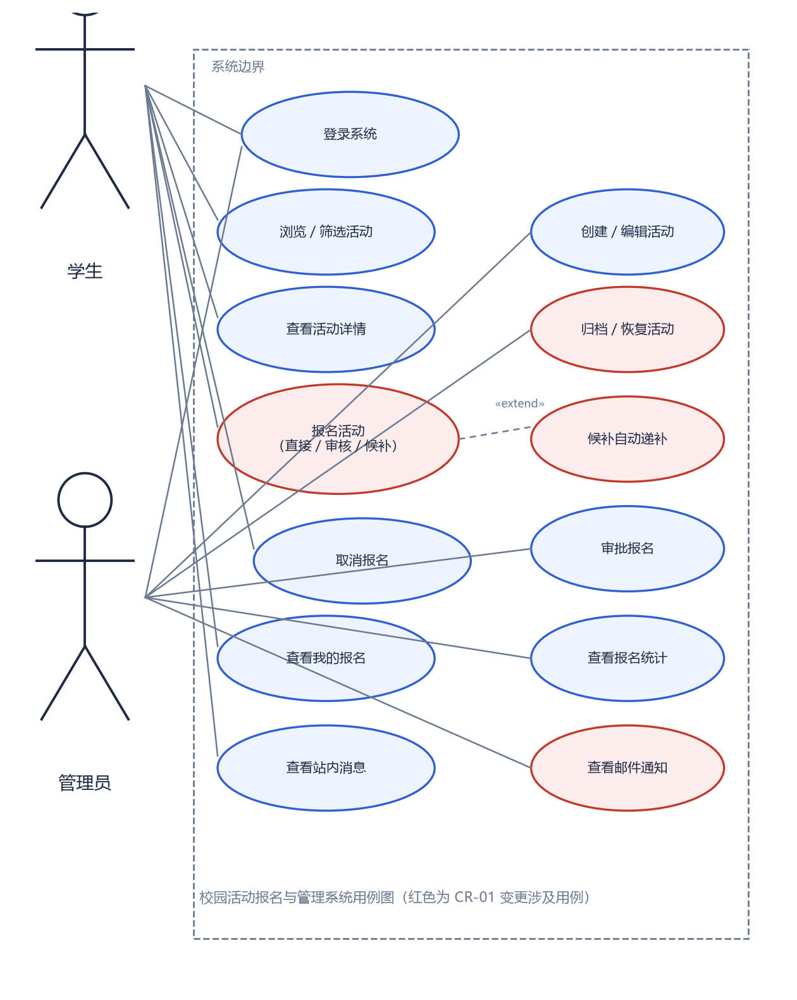

# 02 用例说明与用例图

> 班级：计科2班　学号：242806010216　姓名：陈嘉宏
> 版本：v1.0 初版 + CR-01 变更标注（红色用例）

## 1. 用例图

- 实线：参与者与用例之间的关联；
- 虚线箭头 `«extend»`：候补入队是报名用例的扩展场景（CR-01）；
- 红色用例：CR-01 新增或修改涉及的用例。

## 2. 参与者与用例清单

| 编号 | 用例 | 参与者 | 版本 | 说明 |
| --- | --- | --- | --- | --- |
| UC-01 | 登录系统 | 学生、管理员 | v1 | 账号口令认证，创建会话 |
| UC-02 | 浏览/筛选活动 | 学生 | v1 | 关键字、分类、报名方式筛选 |
| UC-03 | 查看活动详情 | 学生 | v1 | 展示时间、地点、容量、剩余名额、状态 |
| UC-04 | 报名活动 | 学生 | v1 / v2 扩展 | 按策略直接通过、待审核或候补 |
| UC-05 | 取消报名 | 学生 | v1 / v2 增强 | 取消后触发候补递补（v2） |
| UC-06 | 查看我的报名 | 学生 | v1 / v2 增强 | 展示状态、候补位次 |
| UC-07 | 查看站内消息 | 学生 | v1 / v2 增强 | 报名与递补通知 |
| UC-08 | 创建/编辑活动 | 管理员 | v1 | 字段校验与策略选择 |
| UC-09 | 审批报名 | 管理员 | v1 | 批准/拒绝待审核报名 |
| UC-10 | 查看报名统计 | 管理员 | v1 / v2 增强 | 含候补人数与剩余名额 |
| UC-11 | 归档/恢复活动 | 管理员 | v2 | 软删除，保留历史记录 |
| UC-12 | 查看邮件通知 | 管理员 | v2 | 查看邮件发件箱记录 |

## 3. 用例规约

### UC-01 登录系统

| 项 | 内容 |
| --- | --- |
| 参与者 | 学生、管理员 |
| 前置条件 | 账号已存在（演示数据或后台写入） |
| 基本流程 | 1. 输入账号与口令；2. 系统校验；3. 创建会话 Cookie；4. 跳转活动列表（管理员跳转管理后台） |
| 异常流程 | 账号不存在或口令错误：提示“账号或密码错误”，不建立会话 |
| 后置条件 | 会话有效期内可访问受保护页面 |
| 规则 | 口令加盐 SHA-256 校验；Cookie HttpOnly + SameSite=Lax |

### UC-04 报名活动（含 CR-01 候补扩展）

| 项 | 内容 |
| --- | --- |
| 参与者 | 学生 |
| 前置条件 | 已登录；活动存在、未归档、未开始；学生无该活动有效报名 |
| 基本流程 | 1. 学生点击“报名”；2. 系统在事务内读取活动并统计已通过人数；3. 由 `policyType` 选择策略；4. 策略返回初始状态；5. 写入报名记录；6. 提交事务后发布 `RegistrationSubmitted` 事件；7. 通知服务投递站内消息与（v2）邮件；8. 返回结果页 |
| 分支流程 | A. 直接报名且有名额：状态 `approved`；B. 直接报名且满员：拒绝并提示“名额已满”；C. 审核报名：状态 `pending`；D. 候补报名且满员（v2）：状态 `waitlisted`，分配候补序号 |
| 异常流程 | 活动不存在/已开始/已归档、重复报名、容量已满（非候补策略） |
| 后置条件 | 报名记录与通知留痕落库；统计更新 |
| 规则 | BR-06、BR-07、BR-08、BR-11 |

### UC-05 取消报名

| 项 | 内容 |
| --- | --- |
| 参与者 | 学生 |
| 前置条件 | 已登录；报名属于本人且状态为 pending/approved/waitlisted |
| 基本流程 | 1. 点击取消；2. 事务内将状态改为 `cancelled`；3. 若活动未归档，按候补顺序递补（v2）；4. 提交事务；5. 发布取消事件与递补事件；6. 通知相关学生 |
| 异常流程 | 非本人报名（403）；状态不允许取消（400） |
| 后置条件 | 名额释放；被递补学生状态变为 `approved` 并收到通知 |
| 规则 | BR-09；递补与取消同一事务，保证原子性 |

### UC-06 查看我的报名

| 项 | 内容 |
| --- | --- |
| 参与者 | 学生 |
| 基本流程 | 展示本人全部报名：活动名称、开始时间、状态、候补位次（v2）、报名时间 |
| 后置条件 | 无副作用 |

### UC-07 查看站内消息

| 项 | 内容 |
| --- | --- |
| 参与者 | 学生 |
| 基本流程 | 按时间倒序展示消息；打开后标记已读；导航显示未读数 |
| 后置条件 | 未读数更新 |

### UC-08 创建/编辑活动

| 项 | 内容 |
| --- | --- |
| 参与者 | 管理员 |
| 基本流程 | 1. 填写名称、分类、时间、地点、容量、报名方式；2. 校验；3. 保存 |
| 异常流程 | 字段非法；容量小于已通过人数；已有报名时修改报名方式被拒绝 |
| 后置条件 | 活动对学生可见（状态 active） |
| 规则 | BR-01 ~ BR-05 |

### UC-09 审批报名

| 项 | 内容 |
| --- | --- |
| 参与者 | 管理员 |
| 前置条件 | 报名状态为 `pending`，活动未归档 |
| 基本流程 | 1. 打开待审批列表；2. 选择批准/拒绝；3. 批准时事务内再次统计已通过人数并校验容量；4. 更新状态；5. 发布事件并通知学生 |
| 异常流程 | 名额已满批准失败；报名非待审核；非管理员（403）；活动已归档（v2） |
| 后置条件 | 状态更新，学生收到结果通知 |

### UC-10 查看报名统计

| 项 | 内容 |
| --- | --- |
| 参与者 | 管理员 |
| 基本流程 | 展示每个活动的已通过、待审核、已拒绝、已取消、候补人数与剩余名额 |
| 后置条件 | 无副作用 |

### UC-11 归档/恢复活动（CR-01）

| 项 | 内容 |
| --- | --- |
| 参与者 | 管理员 |
| 前置条件 | 活动存在 |
| 基本流程 | 1. 管理员点击“归档”；2. 活动状态改为 `archived`；3. 学生列表与详情不再展示；4. 报名与审批被拒绝；5. 管理员可“恢复”为 `active` |
| 异常流程 | 重复归档幂等返回；活动不存在报错 |
| 后置条件 | 历史报名、消息、通知记录完整保留 |
| 设计说明 | 软删除替代物理删除，避免破坏外键关联与统计历史 |

### UC-12 查看邮件通知（CR-01）

| 项 | 内容 |
| --- | --- |
| 参与者 | 管理员 |
| 基本流程 | 打开“邮件通知”页面，查看收件人、主题、正文、事件、发送时间 |
| 后置条件 | 无副作用；用于演示“多渠道通知”与失败排查 |

## 4. 用例与需求追踪

| 需求 | 用例 |
| --- | --- |
| P2-F01 | UC-02、UC-03 |
| P2-F02、F03、F05 | UC-04 |
| P2-F04 | UC-09 |
| P2-F06 | UC-05 |
| P2-F07 | UC-07、UC-12 |
| P2-F08 | UC-10 |
| P2-F09 | UC-01 |
| P2-F10 | UC-08、UC-11 |
