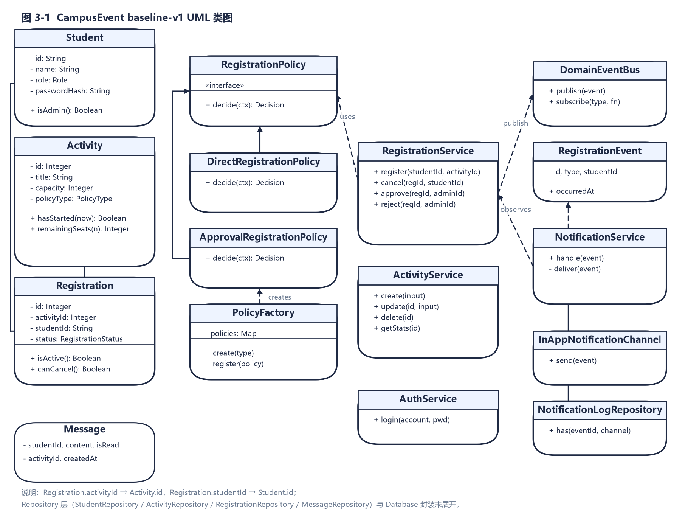

# 03 初版 UML 类图（baseline-v1）

> Git 标签：`baseline-v1`
> 图片：`docs/images/class_v1.png`　可编辑源：`docs/uml/class_v1.mmd`

## 1. 分层与职责

| 层 | 类 | 职责 |
| --- | --- | --- |
| 实体 | `Student` | 学生/管理员身份、角色判断 |
| 实体 | `Activity` | 活动信息、容量、报名方式、是否已开始、剩余名额 |
| 实体 | `Registration` | 报名记录、状态机、是否有效、是否可取消 |
| 实体 | `Message` | 站内消息 |
| 策略 | `RegistrationPolicy`（接口） | 根据活动与已通过人数决定报名初始状态 |
| 策略 | `DirectRegistrationPolicy` | 名额未满即 `approved`，否则拒绝 |
| 策略 | `ApprovalRegistrationPolicy` | 返回 `pending`，等待管理员审批 |
| 工厂 | `PolicyFactory` | 按 `policyType` 选择策略，支持注册新策略 |
| 服务 | `RegistrationService` | 报名/取消/审批/拒绝；事务边界与公共规则 |
| 服务 | `ActivityService` | 活动 CRUD、字段校验、统计 |
| 服务 | `AuthService` | 登录认证与会话用户解析 |
| 事件 | `RegistrationEvent` | 报名领域事件（submitted/approved/rejected/cancelled） |
| 事件 | `DomainEventBus` | 订阅与发布，隔离订阅者异常 |
| 通知 | `NotificationService` | 消费事件，按渠道投递并记录留痕 |
| 通知 | `InAppNotificationChannel` | 写站内消息 |
| 仓储 | `StudentRepository` / `ActivityRepository` / `RegistrationRepository` / `MessageRepository` / `NotificationLogRepository` | SQL 访问与行到实体的映射 |
| 基础设施 | `Database` | sql.js 封装、迁移、事务、落盘 |

## 2. 主要关系

| 关系 | 说明 |
| --- | --- |
| `Registration → Activity`（关联，activityId） | 一次报名属于一个活动 |
| `Registration → Student`（关联，studentId） | 一次报名属于一个学生 |
| `DirectRegistrationPolicy` / `ApprovalRegistrationPolicy` ─|> `RegistrationPolicy` | 策略实现 |
| `PolicyFactory ⇢ RegistrationPolicy` | 工厂创建策略 |
| `RegistrationService ⇢ RegistrationPolicy` | 通过工厂获取策略并调用 `decide` |
| `RegistrationService ⇢ DomainEventBus` | 事务提交后发布事件 |
| `NotificationService ⇢ RegistrationEvent` | 观察者消费事件 |
| `NotificationService → InAppNotificationChannel` | 渠道组合（初版单渠道） |
| `NotificationService → NotificationLogRepository` | 幂等与失败留痕 |
| Service ⇢ Repository | 依赖倒置，便于测试替换 |

## 3. 关键设计说明

1. **公共规则与差异分离**：`RegistrationService.register` 负责“活动存在、未开始、未重复报名”等所有方式共有的规则，策略只回答“初始状态是什么”。新增报名方式无需修改主流程。
2. **事务边界在服务层**：报名写入与名额统计在同一事务；事件在事务提交后发布，避免通知失败回滚业务数据。
3. **状态机集中于实体**：`Registration.isActive()`、`canCancel()` 与枚举标签集中管理，视图不重复判断。
4. **依赖注入**：`app.js` 是唯一装配根，测试可注入临时数据库与固定时钟。

## 4. 设计原则对照

| 原则 | 体现 |
| --- | --- |
| 单一职责 | Service 编排、Policy 决策、Repository 持久化、View 渲染各自独立 |
| 开闭原则 | 新增报名方式通过新增策略类 + 注册实现，主流程不改 |
| 里氏替换 | 所有策略实现同一 `decide(ctx)` 契约 |
| 接口隔离 | 策略接口仅暴露决策所需数据（活动、已通过人数、当前时间） |
| 依赖倒置 | 服务依赖仓储与策略抽象，而非具体 SQL/类 |

## 5. 已知局限（为 CR-01 埋下伏笔）

- `ActivityService.delete` 采用物理删除：有报名记录时直接拒绝，管理员无法下架历史活动。
- 报名状态枚举只有 pending/approved/rejected/cancelled，满员即失败，无排队能力。
- 通知服务只装配一个渠道；新增渠道需修改服务内部逻辑（违反开闭原则的苗头）。
- 统计只覆盖已通过/待审核/已拒绝/已取消。
