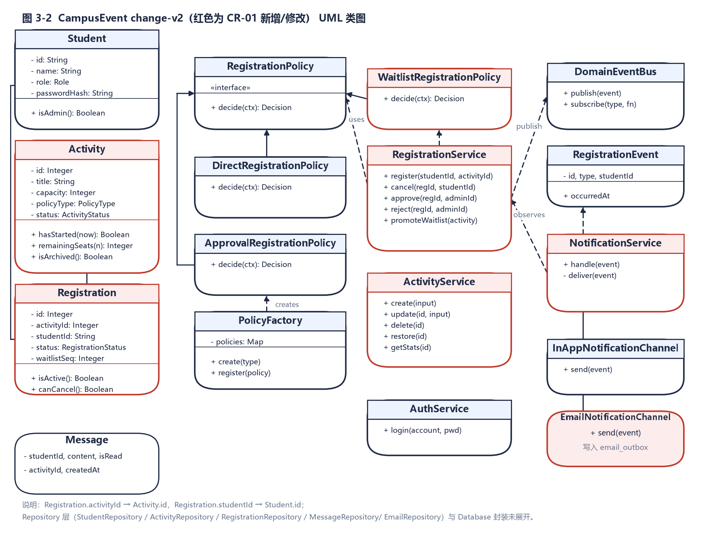

# 04 变更版 UML 类图（change-v2）

> Git 标签：`change-v2`（基于 `baseline-v1`，变更单 CR-01）
> 图片：`docs/images/class_v2.png`　可编辑源：`docs/uml/class_v2.mmd`
> 图中红色边框/底色表示 CR-01 新增或修改的类型。



## 1. 变更摘要

| 类型 | 变更 | 说明 |
| --- | --- | --- |
| `RegistrationStatus` | 新增 `WAITLISTED` | 候补中状态，计入有效报名 |
| `PolicyType` | 新增 `WAITLIST` | 第三种报名方式 |
| `Activity` | 新增 `status`、`isArchived()` | 软删除（归档）能力 |
| `Registration` | 新增 `waitlistSeq` | 候补序号，按入队顺序递补 |
| `WaitlistRegistrationPolicy` | 新增类 | 满员时返回 `waitlisted`，否则 `approved` |
| `RegistrationService` | 新增 `promoteWaitlist()`，cancel 内递补 | 名额释放后原子递补 |
| `ActivityService` | `delete` 改为归档，新增 `restore` | 保留历史报名 |
| `EmailNotificationChannel` | 新增类 | 第二通知渠道（模拟发件箱） |
| `EmailRepository` | 新增类 | `email_outbox` 表访问 |
| `NotificationService` | 支持多渠道组合 | 遍历渠道投递，单渠道失败不影响其他渠道 |
| 数据库 | `002_change_v2.sql` | 增加 `activities.status`、`registrations.waitlist_seq`、`email_outbox` |
| Web 层 | 详情/我的报名/管理后台/邮件页 | 展示候补位次、归档状态、邮件记录 |

## 2. 变更后的类职责

### 2.1 WaitlistRegistrationPolicy

```
decide({ activity, approvedCount }):
    if approvedCount < activity.capacity: return { status: 'approved' }
    return { status: 'waitlisted' }
```

- 与直接报名共享“已通过人数”口径；
- 候补序号由 `RegistrationService` 在事务内按当前候补人数 +1 分配，策略本身不依赖仓储（保持可测试）。

### 2.2 RegistrationService.promoteWaitlist(activity)

- 仅在调用方事务内执行；
- 循环：`seats = capacity - approvedCount`，取候补队列首位，改为 `approved`，直到名额用尽或队列为空；
- 返回被递补列表，由 `cancel` 发布 `RegistrationApproved`（`source='waitlist-promotion'`）事件。

### 2.3 Activity.status 与软删除

- `active`：正常展示与报名；
- `archived`：学生列表/详情不可见（详情页对管理员可见并标注），报名与审批抛出 `ACTIVITY_ARCHIVED`；
- 归档不删除报名、消息、通知记录；管理员可恢复。

### 2.4 EmailNotificationChannel

- 实现与站内消息相同的 `send(event)` 契约；
- 将邮件写入 `email_outbox`，供管理员页面查看；
- 通过 `notification_log(event_id, channel)` 唯一约束保证幂等；
- 单渠道异常被 `NotificationService` 捕获，不影响其他渠道与报名事务。

## 3. 变更前后对比

| 关注点 | baseline-v1 | change-v2 |
| --- | --- | --- |
| 报名方式 | 2 种 | 3 种（新增候补） |
| 满员行为 | 直接失败 / 审核排队待批 | 可进入候补队列，释放后自动递补 |
| 删除活动 | 有报名则物理删除被拒绝 | 归档（软删除），可恢复 |
| 通知渠道 | 站内消息 | 站内消息 + 邮件发件箱 |
| 统计维度 | 4 个状态 | 5 个状态（含候补） |
| 新增业务类 | — | 3 个（候补策略、邮件渠道、邮件仓储） |
| 修改核心类 | — | 2 个（RegistrationService、ActivityService） |
| 数据库迁移 | 001_init.sql | 001 + 002_change_v2.sql |
| 回归用例 | 19 个（16 验收 + 3 通知） | 23 个（新增 4 个 CR 用例，原用例全部通过） |

## 4. 演进性验证

CR-01 的三类变化分别落在既有扩展点上：

| 变化 | 扩展点 | 是否需要改主流程 |
| --- | --- | --- |
| 新增候补报名 | 策略接口 + 工厂注册 | 否（仅登记新策略） |
| 新增邮件渠道 | 通知渠道契约 + 服务组合 | 否（装配根增加一个渠道） |
| 软删除 | 活动状态字段 + 仓储方法 | 局部修改 ActivityService，报名主流程增加归档校验 |

结论：初版识别的变化点（报名规则、通知渠道）被有效隔离；软删除属于数据语义变化，影响可控且通过迁移脚本向前兼容。
