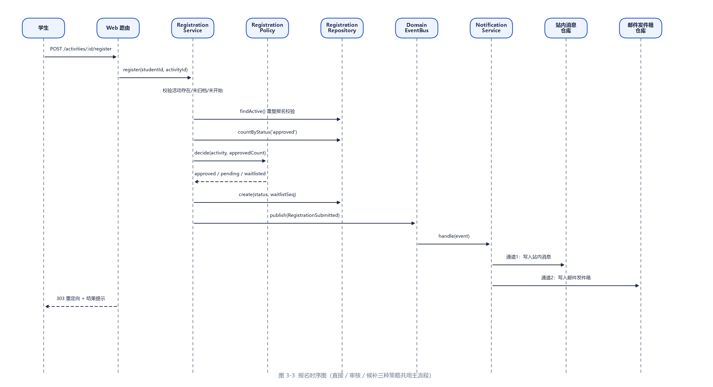
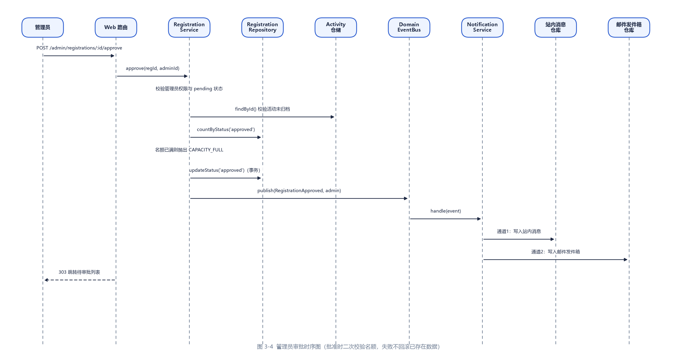
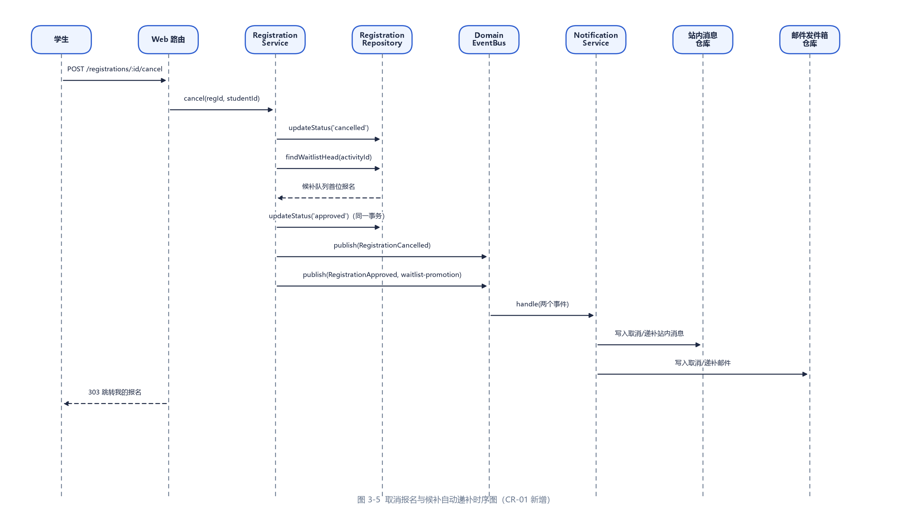

# 05 关键交互时序图

> 班级：计科2班　学号：242806010216　姓名：陈嘉宏

本文件给出三个最关键的交互场景：报名、审批、取消与候补递补。时序图以 change-v2 为准，初版流程是其中的子集。

## 1. 报名时序（直接 / 审核 / 候补共用主流程）



关键点：

1. **Web 层只做参数解析与会话校验**，业务规则进入 `RegistrationService`。
2. **公共规则前置**：活动存在、未归档、未开始、无重复有效报名。
3. **策略只决定初始状态**：`policy.decide({ activity, approvedCount })` 返回 `approved` / `pending` / `waitlisted`；候补序号由服务在事务内分配。
4. **事务提交后发布事件**：报名写入与名额统计在同一事务；事件发布在事务之外，通知失败不会回滚报名。
5. **观察者异步解耦**：`NotificationService` 订阅事件，依次投递站内消息与邮件，任一渠道失败仅记录留痕。

## 2. 管理员审批时序



关键点：

1. 审批前校验操作者角色（Router 守卫 + Service 兜底）。
2. 只有 `pending` 报名可审批；活动归档后审批被拒绝。
3. **批准时二次校验名额**：在事务内重新统计 `approved`，防止多个待审核报名同时批准导致超卖。
4. 批准/拒绝成功后发布事件，学生收到站内消息与邮件。

## 3. 取消报名与候补自动递补（CR-01 新增）



关键点：

1. 取消与递补在**同一事务**内完成，保证“释放一个名额、递补一个人”原子生效。
2. `promoteWaitlist` 按 `waitlist_seq` 升序取候补首位，循环直到名额用尽或队列为空。
3. 事务提交后分别发布：
   - `RegistrationCancelled`：取消者收到确认；
   - `RegistrationApproved`（`source='waitlist-promotion'`）：被递补者收到“递补成功”。
4. 若活动已归档，取消仍可进行，但不触发递补（避免向已下架活动继续放号）。

## 4. 通知投递的内部时序

```
DomainEventBus.publish(event)
        │
        ▼
NotificationService.handle(event)
        │  生成幂等键 event.id = `${registrationId}:${type}`
        ├── for each channel in [in_app, email]:
        │       if notification_log.has(eventId, channel): skip
        │       try channel.send(event) → log(sent)
        │       catch e → log(failed, e.message)，继续下一渠道
        ▼
返回；异常不向报名事务传播
```

该结构保证：

- 同一事件不会重复通知（渠道级幂等）；
- 一个渠道故障不影响另一个渠道；
- 失败原因可追溯到具体事件与渠道。
