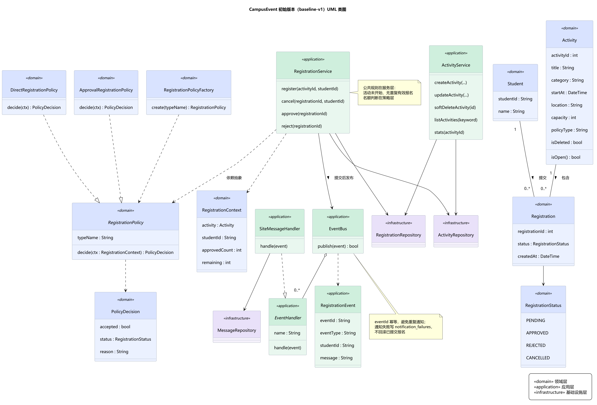

# CampusEvent 初版 UML 类图（baseline-v1）

- 班级：计科2班　学号：242806010216　姓名：陈嘉宏
- 图源：[class_v1.puml](diagrams/class_v1.puml)；矢量图：[class_v1.svg](diagrams/class_v1.svg)



## 1. 分层与职责

| 层 | 主要类 | 职责 |
| --- | --- | --- |
| 领域层 | `Student`、`Activity`、`Registration`、`RegistrationStatus` | 领域数据、状态、活动“是否可报名”的基本判断 |
| 策略 | `RegistrationPolicy`、`DirectRegistrationPolicy`、`ApprovalRegistrationPolicy`、`RegistrationPolicyFactory` | 把“报名结果如何产生”封装为可替换策略 |
| 应用服务 | `ActivityService`、`RegistrationService` | 校验公共规则、控制事务边界、协调仓储、发布事件 |
| 事件/通知 | `EventBus`、`RegistrationEvent`、`EventHandler`、`SiteMessageHandler` | 报名事实与通知渠道解耦，失败隔离与幂等 |
| 基础设施 | `ActivityRepository`、`RegistrationRepository`、`MessageRepository`、`EventLogRepository`、`NotificationFailureRepository` | 封装 SQL，隔离 SQLite 细节 |

## 2. 关键关系

- `Student 1 — 0..* Registration`：一个学生可有多条报名历史；
- `Activity 1 — 0..* Registration`：一个活动可有多条报名；
- `DirectRegistrationPolicy`、`ApprovalRegistrationPolicy` 实现 `RegistrationPolicy`；
- `RegistrationService` 依赖 `RegistrationPolicy` 抽象，通过工厂按 `Activity.policyType` 获取实现；
- `RegistrationService` 在事务提交后调用 `EventBus.publish`；
- `EventBus` 持有 `EventHandler` 列表，当前只有 `SiteMessageHandler`；
- `EventBus` 依赖 `EventLogRepository` 做 eventId 幂等，依赖 `NotificationFailureRepository` 记录通知失败；
- 仓储统一依赖 SQLite 连接，服务层不直接拼 SQL。

## 3. 设计要点

### 3.1 公共规则与策略责任的划分

服务层负责与“报名结果类型”无关的规则：

- 活动存在且未下架；
- 活动未开始；
- 同一学生不存在有效报名；
- 参数与权限校验。

策略负责与报名方式强相关的规则：

- 直接报名：名额是否充足，产生 `APPROVED` 或拒绝；
- 审核报名：产生 `PENDING`，把名额检查推迟到审批。

**理由**：名额判断在不同策略下语义不同（待审核不占名额），如果强行放入服务层会重新出现 `if 活动类型` 分支，违背开闭原则。公共校验则对所有策略一致，放在服务层避免重复。

### 3.2 状态机

```
(无) --直接报名/名额充足--> APPROVED
(无) --审核报名------------> PENDING --批准/有名额--> APPROVED
                                      --拒绝--------> REJECTED
PENDING / APPROVED --学生取消--> CANCELLED
REJECTED / CANCELLED 保留历史，可再次申请
```

审批仅允许 `PENDING → APPROVED/REJECTED`；取消仅允许 `PENDING/APPROVED → CANCELLED`，其他转换由服务层拒绝。

### 3.3 事件与通知

- 报名状态变更先提交事务，再发布事件；
- 通知失败不影响已提交报名，失败信息进入 `notification_failures`；
- `dispatched_events` 以 `event_id` 为主键，重复发布直接忽略，避免重复通知；
- 新增通知渠道只需实现 `EventHandler` 并在 `build_event_bus` 注册。

### 3.4 数据一致性

- `ux_registration_active` 部分唯一索引约束 `(activity_id, student_id)` 在 `pending/approved` 状态下唯一；
- 审批时重新统计 `approved` 数量，防止多个待审核申请同时获批导致超员；
- 金额/名额等计数全部从数据库实时读取，不使用缓存。

## 4. 与需求的对应

| 需求 | 对应类/方法 |
| --- | --- |
| P2-F01 | `ActivityService.createActivity/updateActivity/softDeleteActivity` |
| P2-F02 | `ActivityService.listActivities`、学生活动页 |
| P2-F03 | `RegistrationService.register/cancel`、`RegistrationRepository.findActive` |
| P2-F04 | `DirectRegistrationPolicy`、`ApprovalRegistrationPolicy`、`RegistrationPolicyFactory` |
| P2-F05 | `RegistrationService.approve/reject` |
| P2-F06 | `RegistrationStatus` 与服务层状态校验 |
| P2-F07 | `EventBus`、`SiteMessageHandler`、`MessageRepository` |
| P2-F08 | `ActivityService.stats`、`ActivityStats` |
