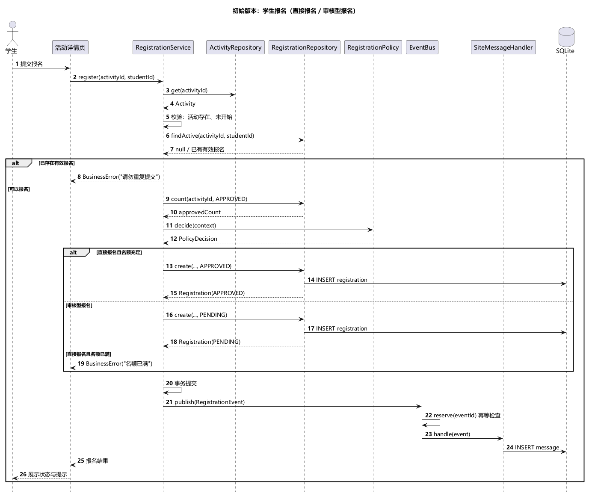
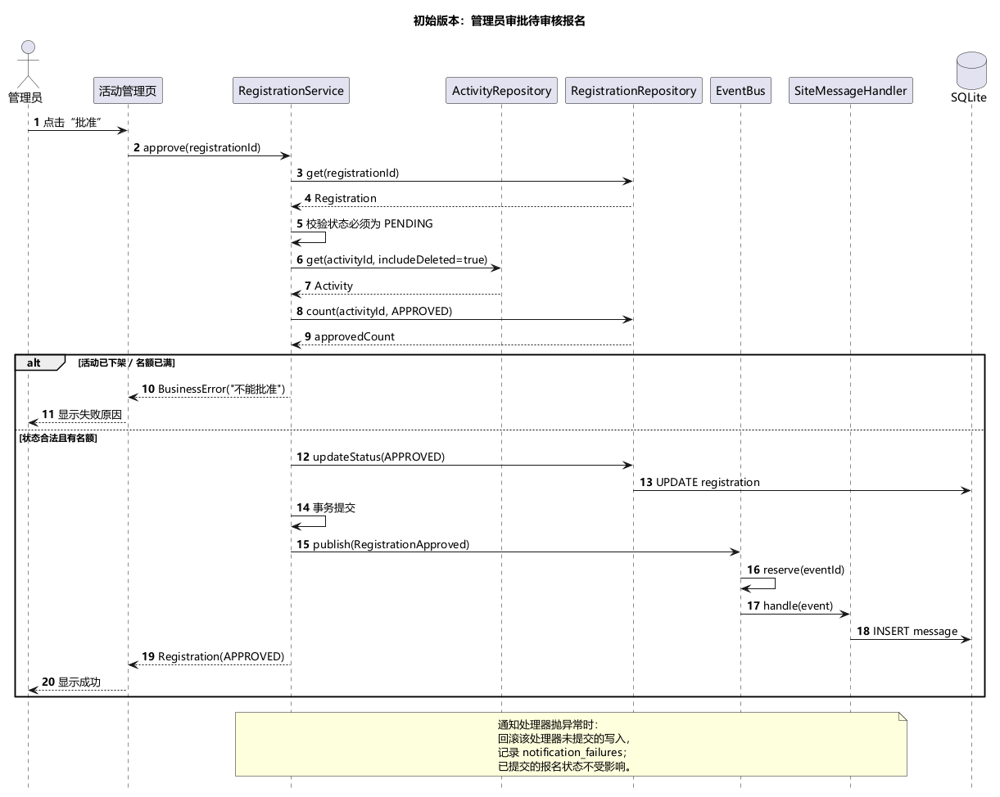

# CampusEvent 初始版本关键时序图

- 班级：计科2班　学号：242806010216　姓名：＿＿＿＿＿＿
- 图源：[seq_registration_v1.puml](diagrams/seq_registration_v1.puml)、[seq_approval_v1.puml](diagrams/seq_approval_v1.puml)

## 1. 学生报名（直接报名 / 审核型报名）

### 步骤说明

1. 学生在活动详情页提交报名，页面调用 `RegistrationService.register`；
2. 服务读取活动并校验“存在、未下架、未开始”；
3. 服务查询是否存在 `pending/approved` 有效报名，若存在直接拒绝；
4. 服务统计已通过人数，组装 `RegistrationContext`；
5. 策略根据 `Activity.policyType` 选择：
   - 直接报名且名额充足：返回 `APPROVED`；
   - 审核报名：返回 `PENDING`；
   - 直接报名且名额已满：拒绝；
6. 服务写入报名记录并提交事务；
7. 事务提交后发布事件，`EventBus` 先做 eventId 幂等，再交给 `SiteMessageHandler` 写站内消息；
8. 通知失败只记录 `notification_failures`，报名结果保持不变。

### 关键设计

- 策略只决定“初始状态”，不直接写数据库；
- 事务提交与事件发布顺序保证“报名不会因通知失败而丢失”；
- 页面提交后重定向到详情页（PRG 模式），避免刷新重复提交。

## 2. 管理员审批待审核报名

### 步骤说明

1. 管理员在活动详情页点击批准，调用 `RegistrationService.approve`；
2. 服务读取报名并校验状态必须是 `PENDING`；
3. 服务读取活动（含软删除标记）并统计已通过人数；
4. 若活动已下架或名额已满，返回业务错误，状态保持待审核；
5. 否则更新为 `APPROVED` 并提交事务；
6. 发布 `RegistrationApproved` 事件，写入站内消息；
7. 管理员页面显示审批结果与刷新后的统计。

### 异常与边界

| 场景 | 系统行为 |
| --- | --- |
| 报名不存在 | 返回 404（管理端） |
| 状态不是待审核 | 业务提示“只有待审核报名可以批准/拒绝” |
| 活动已下架 | 拒绝审批并提示 |
| 名额已满 | 批准失败，报名仍为待审核 |
| 通知失败 | 记录失败日志，审批结果不回滚 |

## 3. 并发与一致性说明

- 审批前重新计数，避免两个管理员同时批准最后两个名额中的三个申请；
- 数据库部分唯一索引防止同一学生并发重复报名；
- SQLite 默认写锁保证单进程/多线程写入串行化；生产部署使用单 worker 多线程（waitress）或 gunicorn 单 worker，避免多进程写竞争导致 `database is locked`。
