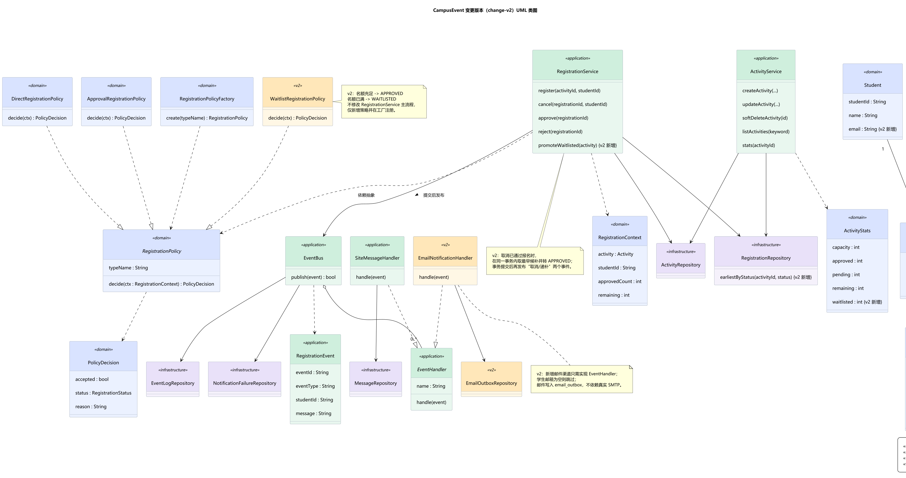
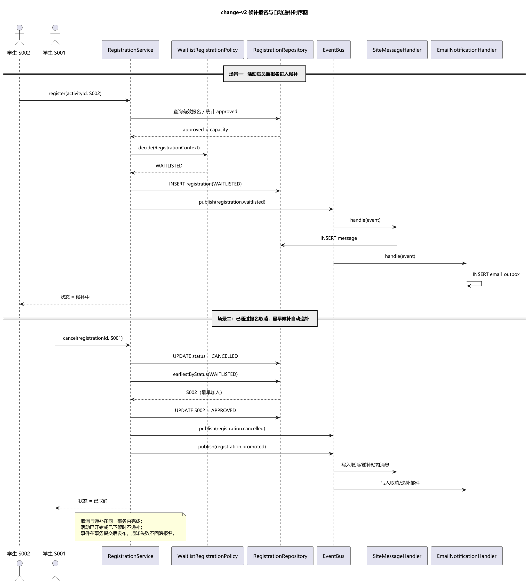

# CampusEvent 变更版 UML 类图与时序图（change-v2）

- 班级：计科2班　学号：242806010216　姓名：＿＿＿＿＿＿
- 图源：[class_v2.puml](diagrams/class_v2.puml)、[seq_waitlist_v2.puml](diagrams/seq_waitlist_v2.puml)
- 矢量图：[class_v2.svg](diagrams/class_v2.svg)、[seq_waitlist_v2.svg](diagrams/seq_waitlist_v2.svg)

## 1. 变更版类图



图中橙色（`<<v2>>`）表示本次变更新增或修改的元素：

| 元素 | 类型 | 变更内容 |
| --- | --- | --- |
| `Student.email` | 字段 | 邮件通知地址，可为空 |
| `RegistrationStatus.WAITLISTED` | 枚举值 | 候补中 |
| `WaitlistRegistrationPolicy` | 新增类 | 满员→候补，否则→已通过 |
| `EmailNotificationHandler` | 新增类 | 模拟邮件订阅者 |
| `EmailOutboxRepository` | 新增类 | 邮件发件箱读写 |
| `RegistrationRepository.earliestByStatus` | 新增方法 | 取最早候补 |
| `RegistrationService.promoteWaitlisted` | 新增方法 | 取消后自动递补 |
| `ActivityStats.waitlisted` | 字段 | 候补人数统计 |

### 1.1 设计的延续性

- `RegistrationPolicy` 抽象未改：新增候补规则只是多一个实现，`RegistrationService` 仍只依赖接口；
- `EventHandler` 协议未改：新增邮件渠道只是多一个订阅者；
- `EventBus`、`SiteMessageHandler`、全部路由未改：扩展点吸收了变更；
- 数据库层通过增加列、表和索引调整完成，不改变原有表的主键与关系。

### 1.2 状态机（v2）

```
(无) --直接报名/有名额--> APPROVED
(无) --审核报名---------> PENDING --批准/有名额--> APPROVED
                                  --拒绝---------> REJECTED
(无) --候补报名/有名额--> APPROVED
     --候补报名/已满----> WAITLISTED --有人取消/有空位--> APPROVED
PENDING / APPROVED / WAITLISTED --学生取消--> CANCELLED
REJECTED / CANCELLED 保留历史，可再次申请
```

约束：

- 同一学生对同一活动，`PENDING / APPROVED / WAITLISTED` 三者互斥（部分唯一索引）；
- 只有 `APPROVED` 占用名额；
- 递补只发生在“已通过报名被取消 + 活动未开始 + 未下架 + 有空位”时。

## 2. 候补报名与自动递补时序图



### 2.1 场景一：满员后进入候补

1. 学生提交报名，`RegistrationService.register` 校验活动存在、未开始、无重复有效报名；
2. 统计 `APPROVED` 数量，组装 `RegistrationContext`；
3. `WaitlistRegistrationPolicy` 判断：名额充足返回 `APPROVED`，否则返回 `WAITLISTED`；
4. 服务写入报名并提交；
5. 提交后发布 `registration.waitlisted`，站内消息与邮件订阅者各自处理。

### 2.2 场景二：取消已通过报名并自动递补

1. 学生取消自己的 `APPROVED` 报名；
2. 同一事务内：更新为 `CANCELLED` → 查询最早 `WAITLISTED` → 若活动未开始/未下架/有空位，更新为 `APPROVED`；
3. 事务提交后依次发布 `registration.cancelled` 与 `registration.promoted`；
4. 两个事件分别做幂等，站内消息和邮件各自收到对应通知。

### 2.3 异常与边界

| 场景 | 系统行为 |
| --- | --- |
| 活动已开始后取消 | 允许取消，但不递补 |
| 活动已下架 | 允许取消历史报名，但不递补 |
| 候补队列为空 | 只发布取消事件 |
| 递补后名额仍有余 | 一次只递补一人，保持队列顺序 |
| 邮件服务异常 | 报名/递补结果不回滚，失败写 `notification_failures` |
| 同一事件重复发布 | `dispatched_events` 主键拦截，不重复通知 |

## 3. 与初始版图的差异说明

| 对比项 | baseline-v1 | change-v2 |
| --- | --- | --- |
| 报名策略实现 | 2 个 | 3 个（新增候补） |
| 通知订阅者 | 1 个（站内消息） | 2 个（站内消息 + 邮件） |
| 报名状态 | 4 个 | 5 个（新增候补） |
| 通知事件 | 4 个 | 6 个（新增候补、递补） |
| 核心服务依赖 | 策略抽象 + 事件总线 | 不变 |

变更版类图保留了初始版的分层结构，新增元素均落在既有扩展点，未出现跨层依赖或循环依赖。
