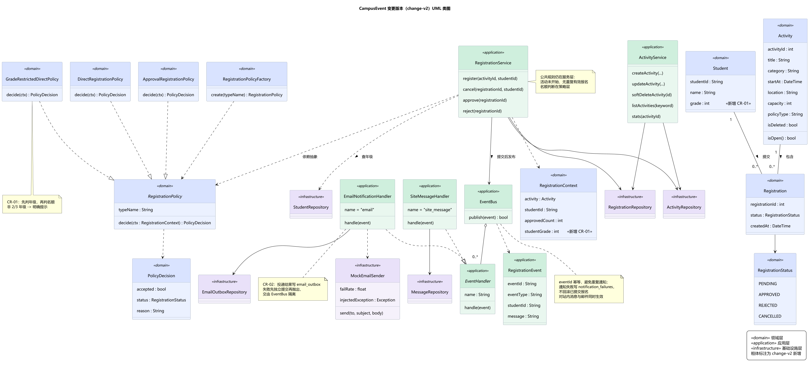
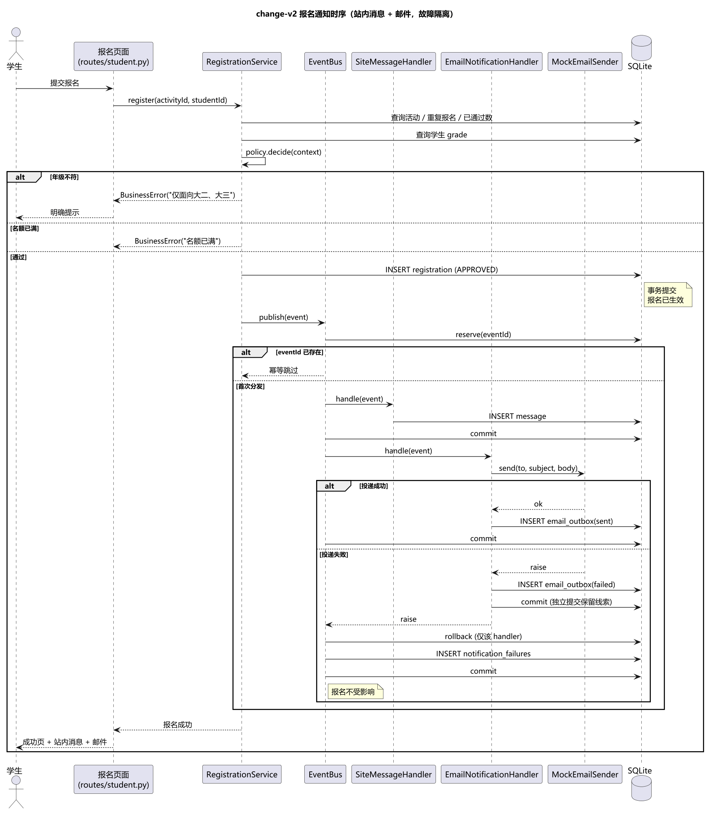

# 需求变更设计说明（change-v2）

> 项目：CampusEvent 校园活动报名与管理系统  
> 变更来源：《实验二教师专用材料》CR-01、CR-02  
> 基线版本：`baseline-v1`（直接报名 + 审核报名 + 站内消息）  
> 变更版本：`change-v2`

---

## 1. 变更内容概述

| 变更单 | 名称 | 一句话说明 |
| --- | --- | --- |
| CR-01 | 新增年级限定报名 | 新增"仅大二、大三可报名"的直接报名规则，其他年级收到明确提示 |
| CR-02 | 新增邮件通知 | 在站内消息之外，用 MockEmailSender 模拟发送邮件，故障不回滚报名、同一事件不重复发送 |

两条变更都要求**尽量不修改核心业务流程**，而是通过既有扩展点（策略注册表、事件订阅者列表）增量实现。

---

## 2. 变更前的扩展点分析

在动手编码前，先确认基线版本已经提供了哪些"插槽"：

| 扩展点 | 位置 | 已有能力 | 本次是否可直接复用 |
| --- | --- | --- | --- |
| 报名策略注册表 | `RegistrationPolicyFactory` | `register()` / `create()`，服务层只依赖抽象 | ✅ CR-01 直接复用 |
| 策略上下文 | `RegistrationContext` | 携带 activity、student_id、approved_count | ⚠️ 需要补 `student_grade` |
| 事件总线 | `EventBus.publish()` | 多 handler 逐个调用、异常隔离、event_id 幂等 | ✅ CR-02 直接复用 |
| 事件订阅者列表 | `build_event_bus()` | 目前只注册 `SiteMessageHandler` | ✅ 追加一个 handler |
| 通知失败留痕 | `notification_failures` 表 | handler 异常自动写入 | ✅ 直接复用 |

**结论**：两条变更都可以在"不改 EventBus、不改服务层事务边界"的前提下完成。这是本次设计成立的前提。

---

## 3. CR-01 年级限定报名设计

### 3.1 设计选择

教师材料提供了两个方向：
1. 新增独立策略
2. 采用"可组合规则"设计

**选择方案 1（新增独立策略）**，理由：

| 维度 | 独立策略 | 可组合规则引擎 |
| --- | --- | --- |
| 与现有架构契合度 | 高（已有策略工厂） | 低（需引入新的规则编排层） |
| 改动范围 | 1 个新类 + 1 行注册 | 新增规则抽象、组合器、执行器 |
| 可读性 | 报名规则名称即类型名，直观 | 规则组合关系需要额外文档 |
| 过度设计风险 | 无 | 有（当前只有 3 条规则） |

当前系统只有 3 类报名规则，引入规则引擎属于为不存在的需求设计，违背最小复杂度原则。

### 3.2 类设计

```
RegistrationPolicy (ABC)
    ▲
    ├── DirectRegistrationPolicy           typeName = "direct"
    ├── ApprovalRegistrationPolicy         typeName = "approval"
    └── GradeRestrictedDirectPolicy        typeName = "grade-restricted-direct"   ← 新增
```

`GradeRestrictedDirectPolicy.decide()` 的判定顺序：

```
1. 年级是否 ∈ {2, 3}
      否 → reject("该活动仅面向大二、大三学生开放，你的年级不符合要求")
2. 名额是否充足（remaining > 0）
      否 → reject("名额已满，无法报名")
3. 全部通过 → accept(APPROVED)
```

顺序很重要：**先判年级再判名额**。这样不符合年级的学生无论名额是否充足都得到"年级不符"的提示，而不是被"名额已满"误导。

### 3.3 上下文扩展

```python
@dataclass(frozen=True)
class RegistrationContext:
    activity: Activity
    student_id: str
    approved_count: int
    student_grade: int = 0   # 新增，带默认值
```

字段带默认值 `0`，因此：
- 旧策略（direct / approval）不读这个字段，行为完全不变
- 任何未传 grade 的旧调用方不会报错

### 3.4 服务层改动

```python
class RegistrationService:
    def __init__(self, ...):
        self.students = StudentRepository(conn)      # 新增 1 行注入

    def register(self, activity_id, student_id):
        # ... 原有校验与策略决策保持不变 ...
        grade = self.students.get_grade(student_id)   # 新增 1 行查询
        decision = policy.decide(RegistrationContext(
            activity=activity,
            student_id=student_id,
            approved_count=approved_count,
            student_grade=grade,                      # 新增 1 个参数
        ))
```

服务层的**事务边界、事件发布顺序、公共校验（活动是否开始、是否重复报名）全部未改**。新增代码仅 3 处。

### 3.5 数据库变更

```sql
ALTER TABLE students ADD COLUMN grade INTEGER NOT NULL DEFAULT 0
    CHECK (grade >= 0 AND grade <= 4);
```

采用**幂等迁移**：启动时用 `PRAGMA table_info(students)` 判断列是否存在，不存在才新增，并给历史演示数据补上年级（S001=2、S002=3、S003=1）。这样已部署的数据库无需删库重建。

### 3.6 边界情况

| 情况 | 处理 |
| --- | --- |
| 学生 grade 为 0（历史数据未补） | 视为不符合，拒绝并提示，不会误放行 |
| 年级符合但名额已满 | 拒绝，提示"名额已满" |
| 年级符合、名额充足、重复报名 | 服务层公共检查拦截，提示"请勿重复提交" |
| 活动已开始 | 服务层公共检查拦截 |
| 原有 direct / approval 活动 | 完全不受影响（旧策略不读 grade） |

---

## 4. CR-02 邮件通知设计

### 4.1 设计选择

沿用 **Observer Pattern**：邮件是一个新的"事件订阅者"，与站内消息平级。

```
EventBus.publish(RegistrationEvent)
    ├── SiteMessageHandler        → messages 表        （原有，未改）
    └── EmailNotificationHandler  → MockEmailSender → email_outbox 表   （新增）
```

**RegistrationService 零改动**：它只负责 `bus.publish(event)`，不关心有几个订阅者、订阅者是谁。

### 4.2 组件职责

| 组件 | 职责 |
| --- | --- |
| `MockEmailSender` | 模拟投递。默认成功；`fail_rate` 概率失败，`injected_exception` 定向失败（用于测试） |
| `EmailNotificationHandler` | 组装主题/正文，调用 sender，把结果写 `email_outbox` |
| `email_outbox` 表 | 记录收件人、主题、正文、事件 ID、状态（sent/failed）、错误、时间 |

### 4.3 三个关键保障

**① 故障隔离 —— 邮件失败不影响报名**

EventBus 对每个 handler 独立 try/except：

```python
for handler in self.handlers:
    try:
        handler.handle(event)
        self.conn.commit()
    except Exception as exc:
        self.conn.rollback()                      # 只回滚该 handler
        self.failure_repo.record(event.event_id, handler.name, repr(exc))
        self.conn.commit()
```

报名事务在 `publish()` 之前就已提交，因此邮件异常不可能导致报名丢失。

**② 失败也留痕 —— 但防止被外层 rollback 清掉**

这是一个实现细节陷阱：如果 handler 里只写 `email_outbox(failed)` 然后 raise，外层 `conn.rollback()` 会把这条失败记录一起回滚。

正确做法是在 handler 内部**先独立提交**失败记录，再抛出异常：

```python
except Exception as exc:
    try:
        self.outbox.add(..., status="failed", error=repr(exc))
        self.conn.commit()        # 独立提交，保住审计线索
    except Exception:
        self.conn.rollback()
    raise                          # 交给 EventBus 做隔离与 notification_failures
```

这样同一次故障会留下**两条证据**：`email_outbox` 的失败记录（业务视角）+ `notification_failures` 的 handler 异常（技术视角）。

**③ 事件幂等 —— 同一事件不发送两次**

复用 `dispatched_events(event_id PRIMARY KEY)`：

```python
def publish(self, event):
    if not self.event_log.reserve(event.event_id):
        return False      # 已分发过，直接忽略所有 handler
    ...
```

幂等控制在 EventBus 一层完成，对所有渠道（站内消息 + 邮件）同时生效，避免每个 handler 各写一套去重逻辑。

### 4.4 事件与邮件主题映射

| 事件类型 | 触发场景 | 邮件主题 |
| --- | --- | --- |
| `registration.approved` | 直接报名通过 / 管理员批准 | CampusEvent 报名通过通知 |
| `registration.pending` | 审核类报名提交 | CampusEvent 报名申请已提交 |
| `registration.rejected` | 管理员拒绝 | CampusEvent 报名申请未通过 |
| `registration.cancelled` | 学生取消 | CampusEvent 报名已取消 |

邮件正文包含活动名称、事件详情与系统落款，收件人按学生构造模拟邮箱 `{student_id}_g{grade}@campus.edu.cn`。

### 4.5 数据库变更

```sql
CREATE TABLE IF NOT EXISTS email_outbox (
    outbox_id  INTEGER PRIMARY KEY AUTOINCREMENT,
    student_id TEXT NOT NULL REFERENCES students(student_id),
    to_email   TEXT NOT NULL,
    subject    TEXT NOT NULL,
    body       TEXT NOT NULL,
    event_id   TEXT REFERENCES dispatched_events(event_id),
    status     TEXT NOT NULL DEFAULT 'sent' CHECK (status IN ('sent','failed')),
    error      TEXT,
    sent_at    TEXT NOT NULL
);
```

使用 `CREATE TABLE IF NOT EXISTS`，与基线 schema 执行方式一致，可重复执行。

---

## 5. 变更后结构

### 5.1 类图



PlantUML 源文件：[diagrams/class_v2.puml](diagrams/class_v2.puml)

新增与变化的部分：
- `Student` 增加 `grade` 属性
- 新增 `GradeRestrictedDirectPolicy`（实现 `RegistrationPolicy`）
- `RegistrationContext` 增加 `studentGrade`
- 新增 `MockEmailSender`、`EmailNotificationHandler`（实现 `EventHandler`）
- 新增 `EmailOutboxRepository`

### 5.2 邮件通知时序



PlantUML 源文件：[diagrams/seq_email_v2.puml](diagrams/seq_email_v2.puml)

关键顺序：**报名写入并提交 → 发布事件 → 依次通知订阅者**。任一步通知失败都不回到报名事务。

---

## 6. 对原有行为的兼容性

| 检查项 | 结论 | 依据 |
| --- | --- | --- |
| 直接报名行为不变 | ✅ | `DirectRegistrationPolicy` 未改，C1—C4 回归通过 |
| 审核报名行为不变 | ✅ | `ApprovalRegistrationPolicy` 未改，C5—C8 回归通过 |
| 取消、重复报名、名额限制不变 | ✅ | 服务层公共规则未改，C3、C9 通过 |
| 站内消息不变 | ✅ | `SiteMessageHandler` 未改，C2、C6、C7 通过 |
| 事件幂等不变 | ✅ | `EventBus` 未改，E13 通过 |
| 旧数据库可升级 | ✅ | `_apply_migrations()` 幂等补列 |

**核心零改动文件**：`app/domain/events.py`、`app/domain/models.py`、所有模板与路由。

---

## 7. 已知取舍

| 取舍 | 说明 |
| --- | --- |
| 只实现"年级限定 + 直接" | 教师材料只要求此一种；"年级限定 + 审核"组合暂不实现，避免过度设计 |
| 邮件同步发送 | 与既有站内消息保持一致；异步化留作后续优化 |
| 邮件地址为构造值 | 教学环境不收集真实邮箱，用学号+年级构造，便于演示与测试 |
| 年级字段默认 0 | 保证旧数据可读；不符合任何年级条件，安全侧拒绝 |
